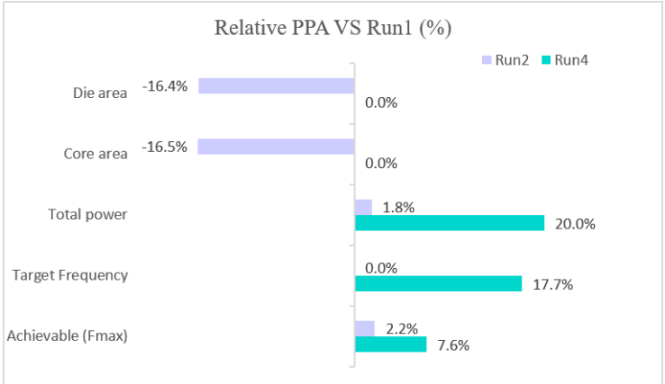
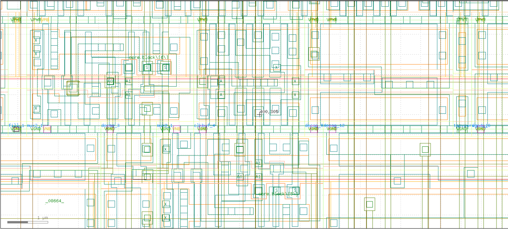
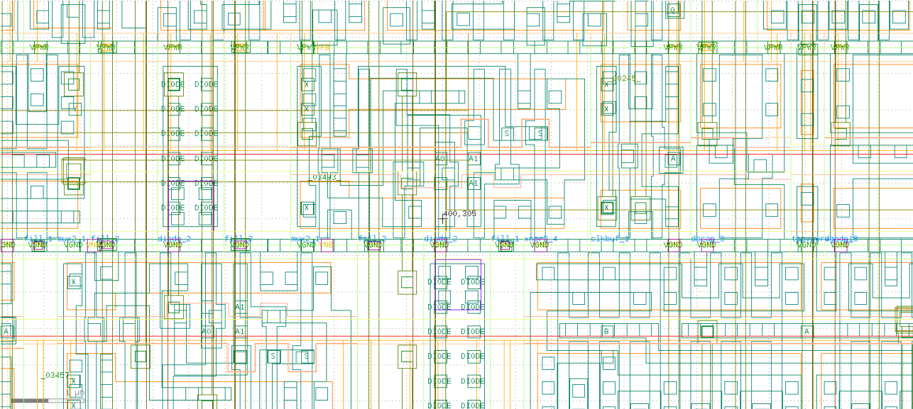

# AES-128 ASIC Physical Design & PPA Optimization (SkyWater 130nm)

An end-to-end ASIC physical design implementation of an AES-128 (Advanced Encryption Standard) cryptographic core utilizing the OpenLane EDA toolchain and the SkyWater 130nm PDK (`sky130HD`).

This project explores the design space and trade-offs between Power, Area, and Frequency (PPA) across multiple physical design iterations, featuring critical path static timing analysis (STA), clock tree synthesis (CTS) tuning, design rule checking (DRC), and layout versus schematic (LVS) signoff verification.

---

## Key Highlights & Design Strategies

* **PPA Optimization:** Explored design space trade-offs across 5 distinct runs ranging from aggressive area minimization to clock speed optimization.
* **Timing Closure:** Diagnosed setup timing bottlenecks and fanout/slew electrical violations using OpenSTA static timing analysis.
* **Physical Signoff:** Verified structural manufacturability using Magic/KLayout for DRC, Netgen for LVS, and Spef-Extractor for parasitic extraction.

---

## Design Iteration Summary

The project evaluates five distinct physical implementation runs:

* **Run 1 — Baseline:** Default design flow with baseline clock constraint ($T_{target}$ = 10.0 ns) and standard floorplan parameters.
* **Run 2 — Area Optimization:** Reduced core utilization and floorplan footprint to minimize total chip area and power consumption.
* **Run 3 — Case Study (Unclosable Timing):** An intentional "timing squeeze" experiment using an extremely aggressive clock target ($T_{target}$ = 5.0 ns) to force setup timing failure (WNS < 0) and observe critical path degradation.
* **Run 4 — Performance Optimization:** Pushed core operating frequency ($T_{target}$ = 8.5 ns) while maintaining positive setup slack and timing closure.
* **Run 5 — Case Study (Timing Resolution):** Applied global optimization parameters in `config.json` (buffer insertion, max fanout limits, drive strength scaling) to successfully close timing on a challenging clock target.

---

## PPA Comparison Table

| Run ID | Flow Objective | Target Clock | Achieved Maximum Frequency (MHz) | WNS (Setup) | Core Utilization | Total Power (mW) | Signoff Status |
| :--- | :--- | :---: | :---: | :---: | :---: | :---: | :---: |
| **Run 1** | Baseline | 10.0 ns | 112.11 | +1.08 ns | 40% | 165 | **Clean** |
| **Run 2** | Area-Optimized | 10.0 ns | 114.55 | +1.27 ns | 48% | 168 | **Clean** |
| **Run 3** | Timing Stress Case | 5.0 ns | -- | Negative | 40% | N/A | **Timing Violation** |
| **Run 4** | Performance-Optimized | 8.5 ns | 120.63 | +0.21 ns | 40% | 198 | **Clean** |
| **Run 5** | Global Optimization Case | 8.2 ns | 125.79 | +0.25 ns | 40% | 208 | **Clean** |

---

## PPA Analysis Graphs & Physical Layouts

### Performance & Area Trade-Off Graphs

### Final Physical Layout Comparison
| Run 1 — Baseline Layout | Run 4 — Performance Layout |
| :---: | :---: |
|  |  |

---

## Toolchain & PDK Information

* **EDA Toolchain:** OpenLane v1.x (Yosys, OpenROAD, OpenSTA, Magic, Netgen, KLayout)
* **Process Design Kit (PDK):** SkyWater 130nm High Density (`sky130_fd_sc_hd`)
* **Top Module:** `aes`

---

## Acknowledgements

* **RTL Design:** The AES-128 core IP used in this project was created by **Joachim Strömbergson** ([secworks/aes](https://github.com/secworks/aes)).
* **EDA Toolchain:** OpenLane, Yosys, OpenROAD, OpenSTA, Magic, and KLayout communities.
* **PDK:** SkyWater 130nm PDK project.
